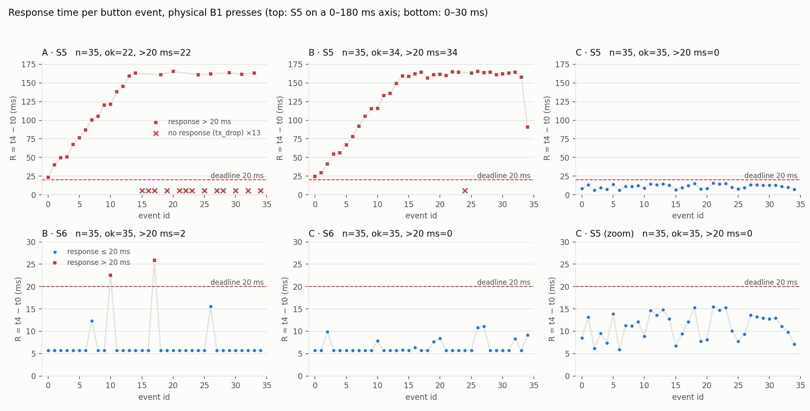

# Hafta 02: Tasarım Kararını Savun (A/B/C)

Aynı kart ve aynı yük altında üç tasarımı karşılaştırıyoruz:

| Sürüm | Görev öncelikleri | Mesaj seçimi |
|---|---|---|
| A | TEL 3 > BTN 2 > TX 1 | Ortak FIFO |
| B | BTN 4 > TEL 3 > TX 1 | Ortak FIFO |
| C | BTN 4 > TEL 3 > TX 1 | Aktarım sınırında BTN önce |

Soru şu: Görev önceliğini değiştirmek ile mesaj sırasını değiştirmek, buton yanıtını (R = t₄ − t₀) ve telemetriyi nasıl etkiliyor?

| Belge | İçerik |
|---|---|
| [analysis/report.md](analysis/report.md) | **Analiz raporu**: sonuçlar, A/B ve B/C farkı, telemetri bedeli, ölçüm sınırları |
| [measurements/](measurements/) | Ham seri oturumları (`*_raw.txt`), kayıtlar (`*.csv`), sayaçlar (`*_meta.txt`), [özet](measurements/summary.csv) |
| [ai-usage.md](ai-usage.md) | Yapay zekâ kullanımı ve doğrulama |

## Sonuç özeti

Her koşuda 35 fiziksel B1 basışı yapıldı. R değerleri ms cinsinden, yalnızca yanıtı gelen olaylar için.

| Koşu | Yanıt | R medyan | R maks | > 20 ms | Kayıp BTN / TEL | Değişen aşama |
|---|---|---|---|---|---|---|
| A-S5 | 22/35 | 130,1 | 165,3 | 22 | 13 / 8 | (referans) |
| B-S5 | 34/35 | 158,4 | 165,4 | 34 | 1 / 19 | t₁−t₀: 1,32 → 0,02 ms |
| C-S5 | **35/35** | **11,3** | **15,5** | **0** | 0 / 21 | t₃−t₂: 122,8 → 5,5 ms |
| B-S6 | 35/35 | 5,7 | 25,9 | 2 | 0 / 0 | |
| C-S6 | 35/35 | 5,7 | 11,1 | 0 | 0 / 0 | t₃−t₂ maks: 20,3 → 5,5 ms |

- **A → B:** Button önceliği yalnızca görev beklemesini (t₁−t₀) kaldırdı. S5'te R düzelmedi, çünkü süre FIFO'da TEL mesajlarının arkasında geçiyor. Kaybolan mesaj BTN'den TEL'e kaydı; toplam kayıp aynı kaldı.
- **B → C:** BTN'yi aktarım sınırında öne almak t₃−t₂'yi düşürdü. S5'te bütün yanıtlar 20 ms'nin altında kaldı.
- **Bedeli telemetri ödüyor:** S5'teki 21 kaybın hepsi TEL. TEL'in en uzun beklemesi S5'te 150 ms'den 160 ms'ye, S6'da 19,9 ms'den 22,5 ms'ye çıktı.



## Nasıl çalıştırılır?

### 1. Firmware

1. CubeIDE'de `firmware/odev02` klasörünü proje olarak içe aktar (*File → Import → Existing Projects into Workspace*).
2. **Debug** yapılandırmasıyla derle ve karta yükle.

Tek bir derleme bütün koşular için kullanılır: sürüm ve senaryo, PC'den gönderilen `RUN` komutuyla seçilir. Komut sözdizimi: [`App/lab.h`](firmware/odev02/App/lab.h).

### 2. Ölçüm

```sh
cd hafta-02/interface
pip install -r requirements.txt
python capture.py matrix                                  # A/B/C-S5 ve B/C-S6, fiziksel basış
python capture.py run --variant C --scenario S6           # tek koşu
python capture.py run --variant A --scenario S5 --inject auto   # otomatik basış (destekleyici)
```

Her koşuda kart yeniden başlar ve 5 s ısınır. **LD2 yanınca** B1'e 35 kez bas: basışlar arası en az 0,5 s, ritmi değiştirerek. Kart export'u bitirince sıradaki koşuya geçer.

Her koşu için üç dosya yazılır:
- `<koşu>_raw.txt`: karttan gelen bütün satırlar (TEL, BTN, LAB, CFG, REC, TSK, CNT)
- `<koşu>.csv`: olay başına t₀…t₄ ve durum
- `<koşu>_meta.txt`: ayarlar, görev öncelikleri ve sayaçlar

### 3. Analiz

```sh
pip install matplotlib numpy
python hafta-02/analysis/analyze.py                            # resmî ölçümler
python hafta-02/analysis/analyze.py hafta-02/measurements/tekrar   # tekrar ölçümü
```

Özet tabloyu ve `analysis/plots/` altındaki grafikleri yalnızca ham dosyalardan yeniden üretir.

### Tekrar ölçümü

18 Ekim 2026'da aynı firmware ile beş koşu fiziksel basışla yeniden alındı: [`measurements/tekrar/`](measurements/tekrar/), grafikler [`analysis/plots/tekrar/`](analysis/plots/tekrar/). Sonuçlar ilk ölçümle aynı yönde:

| Koşu | Yanıt | > 20 ms | R maks (ms) | Kayıp BTN / TEL |
|---|---|---|---|---|
| A-S5 | 22/35 | 22 | 165,3 | 13 / 7 |
| B-S5 | 35/35 | 35 | 165,2 | 0 / 20 |
| C-S5 | 35/35 | 0 | 15,4 | 0 / 21 |
| B-S6 | 35/35 | 2 | 23,5 | 0 / 0 |
| C-S6 | 35/35 | 0 | 10,1 | 0 / 0 |

`tekrar/A-S5_raw.txt` içinde `TEL,0` yok: kart RUN geldiğinde varsayılan ayarla (adı yine A-S5) çalışıyordu ve bu satır reset baytıyla birleşip bozuldu; araç bozuk satırı attı. Ham TEL sayısı bu yüzden `tel_sent` değerinden 1 eksik (4658 / 4659); diğer dört koşuda eşit.

### Ölçüm notları

- **`A-S5_raw.txt` ilk satırı:** RUN geldiğinde kart varsayılan ayarla çalışıyordu (adı yine A-S5). Önceki çalışmanın yarım kalmış TEL satırı ve bir reset baytı (0xF0), yeni koşunun `TEL,0` satırıyla tek satırda birleşti. Ham dosya değiştirilmedi.
  - CSV, sayaçlar ve analiz bu satırı kullanmıyor.
  - Araç artık sıra numarası geri giden satırları ve 64 bayttan farklı satırları koşu başlamadan önce atıyor (`RunFilter`, test: `tests/test_capture.py`).
- **C-S5'in süresi:** İlk basıştan sonra yaklaşık 10 dakika ara verildi. R ölçümünü etkilemiyor, ama koşu 653 s sürdü. Bu yüzden S5'te TEL bekleme ortalaması koşular arasında karşılaştırılmadı.

## Ölçülen firmware ve sürümler

| | |
|---|---|
| Firmware commit'i | `7ad8acd` (main, [PR #2](https://github.com/alitalhq/freertos-bootcamp/pull/2)). Ölçümler PR dalındaki `492bc21` ile alındı; `git diff 492bc21 7ad8acd -- hafta-02/firmware` boş, yani firmware aynı. |
| Kart | NUCLEO-L476RG, 80 MHz (HSI → PLL) |
| Araçlar | STM32CubeIDE 2.2.0 (GNU Tools for STM32 14.3), STM32CubeMX 6.18.1, FW_L4 1.18.2 |
| RTOS | FreeRTOS 10.3.1, CMSIS-RTOS v2, tick 1 kHz |
| PC | macOS, Python 3.13.5, pyserial 3.5, matplotlib 3.10.8, numpy 2.2.6 |
| Ölçüm tarihi | 6 Ekim 2026 |

## Hafta 1'den farklar

- **Proje:** `odev02`, Hafta 1 projesinin kopyası. Hafta 1 olduğu gibi duruyor.
- **Sürüm seçimi:** `RUN var=A|B|C` ile.
- **C'nin kuyruk düzeni:** BTN yanıtları `urgent_q`'ya gider. İki kuyruk ve iki counting semaphore ile toplamda en fazla 16 mesaj bekleyebilir.
- **S6:** her 100 ms'de 4 TEL.
- **TEL bekleme istatistiği:** kuyruğa giriş → gönderim başlangıcı, export'ta `CNT,tel_wait_*`.
- **Kaldırılanlar:** Hafta 1'in standart dışı çözümleri (TC zinciri, UART önceliği) bu projede yok. Böylece sürümler yalnızca tek değişkende farklı.
- **Referans proje kullanılmadı:** hocanın paylaştığı FreeRTOS 11.1 projesi değil, Hafta 1'deki kendi projemiz temel alındı.
