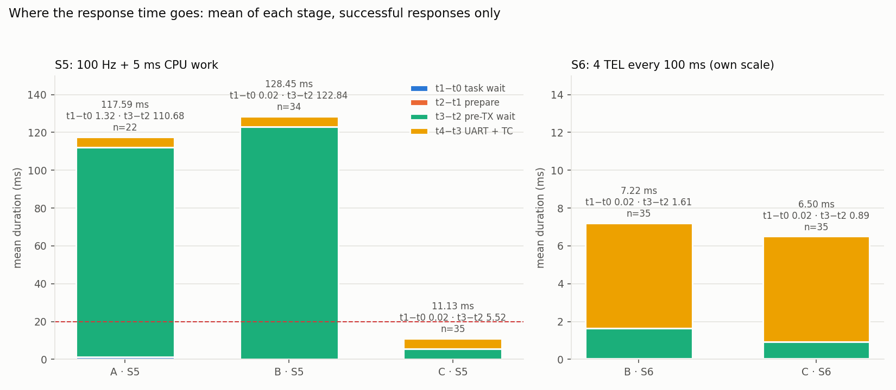
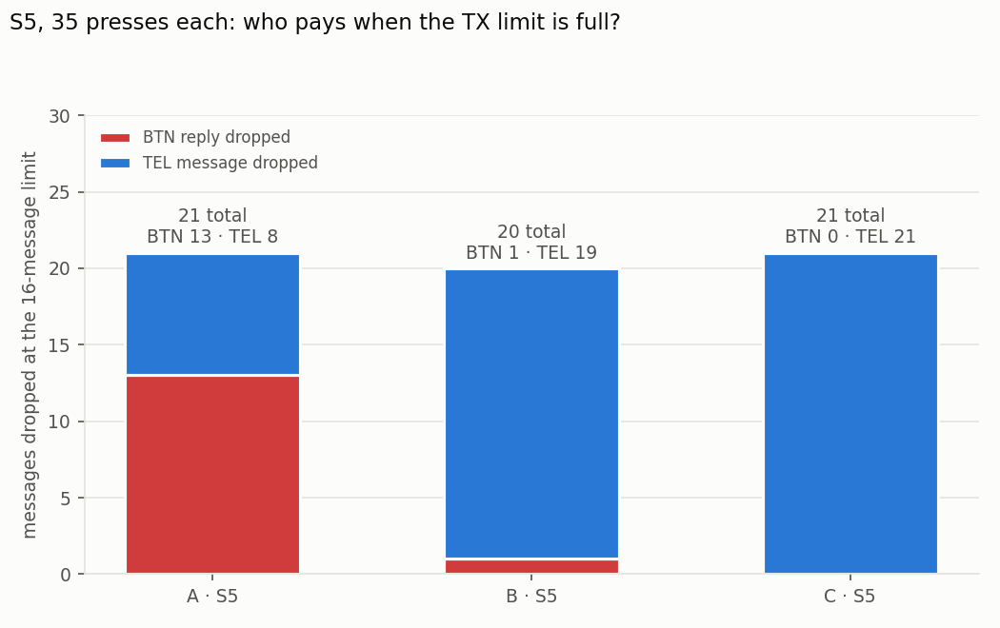
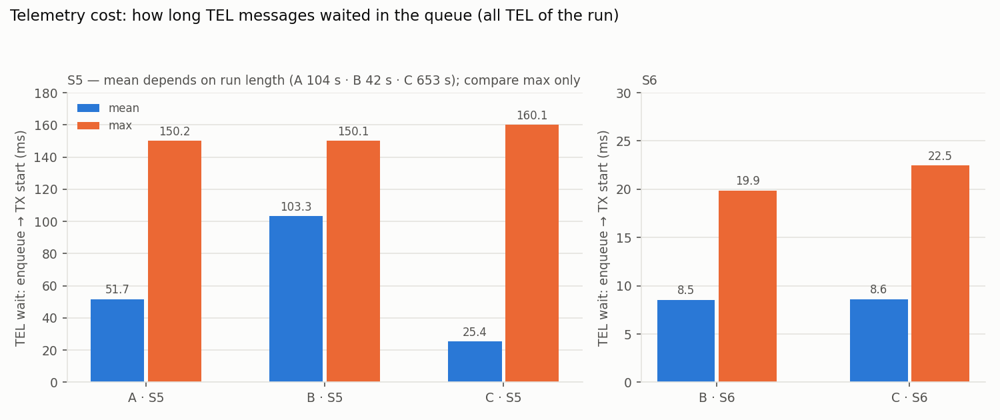

# Ödev 2 Analiz Raporu: A/B/C karşılaştırması

Tüm sayılar `measurements/` altındaki ham kayıtlardan `analysis/analyze.py` ile üretildi. Özet tablo: [`measurements/summary.csv`](../measurements/summary.csv).

## Deney koşulları

| | |
|---|---|
| Kart | NUCLEO-L476RG, 80 MHz, Debug derlemesi (-O0) |
| RTOS | FreeRTOS 10.3.1 (CMSIS-RTOS v2), tick 1 kHz |
| UART | USART2, 115200 8N1, 64 baytlık mesaj (hatta 5,56 ms) |
| Kuyruk | Toplam en fazla 16 bekleyen TX mesajı (C'de iki kuyruğun toplamı) |
| Basış | Fiziksel B1, koşu başına 35 kabul edilen basış, 5 s ısınma |
| Basış aralığı | En kısa 537 ms (≥ 0,5 s şartı sağlandı), ritim elle değiştirildi |
| Firmware | `hafta-02/firmware/odev02`, tek derleme; sürüm ve senaryo `RUN` komutuyla seçildi |

| Sürüm | Görev öncelikleri | Mesaj seçimi |
|---|---|---|
| A | TEL 3 > BTN 2 > TX 1 | Ortak FIFO |
| B | BTN 4 > TEL 3 > TX 1 | Ortak FIFO |
| C | BTN 4 > TEL 3 > TX 1 | Aktarım sınırında BTN önce |

Yükler:
- **S5:** 100 Hz telemetri ve her periyotta ~5 ms CPU işi.
- **S6:** her 100 ms'de art arda 4 TEL mesajı, CPU işi yok.

## Sonuçlar

| Koşu | Yanıt | > 20 ms | R medyan / p95 / maks (ms) | t1−t0 ort / maks | t3−t2 ort / maks | Kayıp BTN / TEL | TEL bekleme maks |
|---|---|---|---|---|---|---|---|
| A-S5 | 22/35 | 22 | 130,1 / 163,7 / 165,3 | 1,32 / 4,95 | 110,7 / 159,7 | 13 / 8 | 150,2 ms |
| B-S5 | 34/35 | 34 | 158,4 / 164,6 / 165,4 | 0,02 / 0,03 | 122,8 / 159,8 | 1 / 19 | 150,1 ms |
| C-S5 | 35/35 | 0 | 11,3 / 15,3 / 15,5 | 0,03 / 0,04 | 5,52 / 9,86 | 0 / 21 | 160,1 ms |
| B-S6 | 35/35 | 2 | 5,7 / 17,6 / 25,9 | 0,02 / 0,03 | 1,61 / 20,25 | 0 / 0 | 19,9 ms |
| C-S6 | 35/35 | 0 | 5,7 / 10,2 / 11,1 | 0,02 / 0,03 | 0,89 / 5,48 | 0 / 0 | 22,5 ms |

Ek bilgiler:
- Hazırlama (t2−t1) her koşuda ~0,03 ms, gönderim (t4−t3) 5,56 ms.
- Timeout, UART hatası ve kayıt taşması hiçbir koşuda olmadı.

## A/B farkı hangi aralıkta oluştu?

**t1−t0'da.**
- A'da ButtonTask (öncelik 2), TelemetryTask'ın (öncelik 3) 5 ms'lik işinin bitmesini bekliyor: ortalama 1,32 ms, en çok 4,95 ms.
- B'de ButtonTask bu işi kesiyor ve bekleme 0,02 ms'ye iniyor.

Bu, scheduler'ın etkisi: hazır görevler arasında en yüksek öncelikli olan çalışır.

**Ama R düzelmedi.** Her iki sürümde de ulaşan yanıtların hepsi 20 ms'yi aştı. Sürenin neredeyse tamamı t3−t2'de, yani yanıt hazır olduktan sonra kuyrukta beklerken geçiyor. ButtonTask'ın önceliği, ortak FIFO'da önüne girmiş TEL mesajlarını geriye almıyor.

**Birikimin nedeni:**
- UartTxTask (öncelik 1), CPU işi yüzünden her 10 ms'lik periyotta yalnızca bir mesaj başlatabiliyor. Bu, telemetrinin ürettiği hızla aynı.
- Her basış kuyruğa fazladan bir mesaj ekliyor ve bu fazlalık hiç erimiyor. A'nın ilk 14 olayında R her basışta yaklaşık 10 ms büyüyor.
- Birikim 16 mesaj sınırına ulaşınca R ~160 ms'de sabitleniyor. Kayıtta en yüksek toplam bekleme 16, TEL'in en uzun beklemesi de 150 ms (≈ 15 × 10 ms).

**B, kaybın kime düştüğünü değiştirdi.**
- A'da 13 BTN yanıtı kayboldu, B'de 1.
- Buna karşılık TEL kaybı 8'den 19'a çıktı. Toplam kayıp ise neredeyse aynı: 21 ve 20.
- Açıklamamız şöyle: kuyrukta tek yer kaldığında A'da TelemetryTask mesajını önce koyuyor, B'de ButtonTask önce koyuyor. Bu açıklama bir hipotez; sayılarla uyumlu ama sıralamayı doğrudan görmedik.

B'nin medyan R değerinin A'dan yüksek görünmesi (158 ms'ye karşı 130 ms) bir iyileşme ya da kötüleşme değil. A'da kuyruk doluyken gelen yanıtlar kaybolduğu için ortalamaya hiç girmedi. B'de ise o yanıtlar ulaştı ama ~160 ms gecikmeyle.

## B/C farkı hangi aralıkta oluştu?

**t3−t2'de.** Görev öncelikleri aynı; yalnızca gönderim seçimi değişti.
- S5'te t3−t2 ortalaması 122,8 ms'den 5,52 ms'ye indi.
- En uzun R 15,5 ms oldu; geciken ya da kaybolan yanıt yok.
- S6'da t3−t2'nin en uzun değeri 20,25 ms'den 5,48 ms'ye, en uzun R 25,9 ms'den 11,1 ms'ye indi. B-S6'daki 2 gecikme, basışın 4 TEL'lik darbenin hemen arkasına denk geldiği olaylar.

**C'de t3−t2 neden hâlâ sıfır değil:**
- **S6'da:** BTN, hatta o an giden TEL'in bitmesini bekliyor. Sürmekte olan aktarım yarıda kesilmiyor, bu yüzden bekleme en fazla 5,56 ms; ölçülen en uzun değer 5,48 ms.
- **S5'te:** ölçülen en uzun değer 9,86 ms. Bu, tek mesaj süresinden uzun. Açıklamamız: TC kesmesinden sonra UartTxTask'ın (öncelik 1) bir sonraki mesajı başlatabilmesi için 5 ms'lik CPU işinin bitmesi gerekiyor. Bu bekleme zaman damgalarından çıkarım; doğrulamak için iz kaydı (SystemView) gerekiyor.

## Telemetri ne kazandı veya kaybetti?

**S5'te kazanç yok.**
- C de birikimi çözmüyor: kuyruk yine 16'da doluyor.
- 21 kaybın hepsi TEL'den: C, kaybı tamamen telemetriye yüklüyor.
- TEL'in en uzun beklemesi 150 ms'den 160 ms'ye çıktı. Bunun nedeni, BTN'nin her seferinde bir TEL'in önüne geçmesi.

**S6'da bedel küçük.**
- Kayıp yok, en yüksek toplam bekleme 5 mesaj.
- TEL'in en uzun beklemesi 19,9 ms'den 22,5 ms'ye çıktı (+2,6 ms). Ortalama bekleme 8,54 ms'den 8,62 ms'ye çıktı; fark çok küçük.

S5'teki ortalama TEL beklemeleri birbiriyle karşılaştırılamaz:
- Ortalama, koşunun ne kadar sürdüğüne bağlı. Koşu süreleri 104 s (A), 42 s (B) ve 653 s (C).
- C-S5'te ilk basıştan sonra uzun bir ara verildi.
- Bu yüzden S5 için yalnızca en uzun bekleme karşılaştırıldı.

## Ölçüm hangi iddiayı kanıtlamıyor?

- **En kötü durumu kanıtlamıyor.** Her koşuda 35 olay ve her koşul için tek koşu var. Ölçülen en uzun R bir üst sınır değil.
- **Basış fazı kontrol edilmedi.** Basışlar elle yapıldı. B-S6'daki 2 gecikme, basışın TEL darbesine denk gelmesine bağlı; başka bir basış dizisinde bu sayı değişebilir.
- **Görevin ne zaman çalışmaya hazır olduğu ölçülmedi.** "CPU'yu bekliyor" ve "kuyrukta bekliyor" yorumları t0–t4 damgalarından çıkarım. Doğrudan görmek için iz kaydı gerekiyor; bu, SystemView ödevinin konusu.
- **A ile B'de kaybın yer değiştirmesinin nedeni** bir hipotez. Sayılar açıklamayla uyumlu, ama olayların sırası gözlenmedi.
- **C'nin adil olduğunu kanıtlamıyor.** C katı öncelik uyguluyor; burada basışlar arası en az 0,5 s'ydi. Sürekli buton trafiğinde telemetri aç kalabilir.
- **Başka bir uygulamaya genellenemez.** Sonuçlar bu firmware'e özgü: UartTxTask öncelik 1, IT ile gönderim ve TC bildirimi, 115200 baud, -O0. Referans proje (FreeRTOS 11.1) farklı sayılar verebilir.
- **S5 ile S6 doğrudan karşılaştırılmaz.** Yükler farklı; sürümler arasındaki farkı ölçmek için her yük kendi içinde karşılaştırıldı.

## Karar

Bu iki yükte buton yanıtı için en uygun sürüm C:
- S5'te R'yi 160 ms'den 15,5 ms'ye indirdi.
- S6'da her yanıtı 20 ms'nin altında tuttu.

Bedeli telemetrinin ödüyor:
- S5'teki bütün kayıplar TEL'den.
- TEL'in en uzun beklemesi biraz arttı.

Bu sonuç, burada ölçülen basış hızı (en az 0,5 s aralık) ve bu yükler dışında garanti vermez. S5'teki birikimin asıl nedeni, düşük öncelikli UART görevinin her periyotta yalnızca bir mesaj başlatabilmesi. Bu darboğaz C ile kalkmıyor; yalnızca BTN darboğazın önüne geçiyor.
