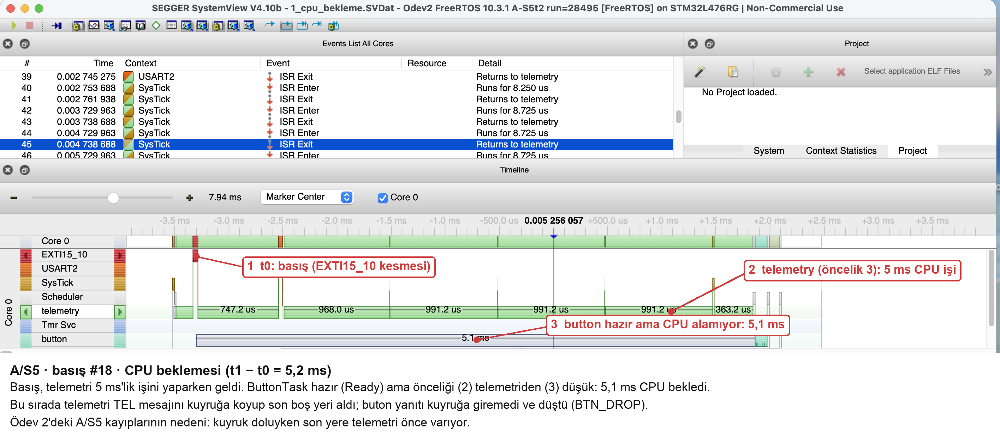
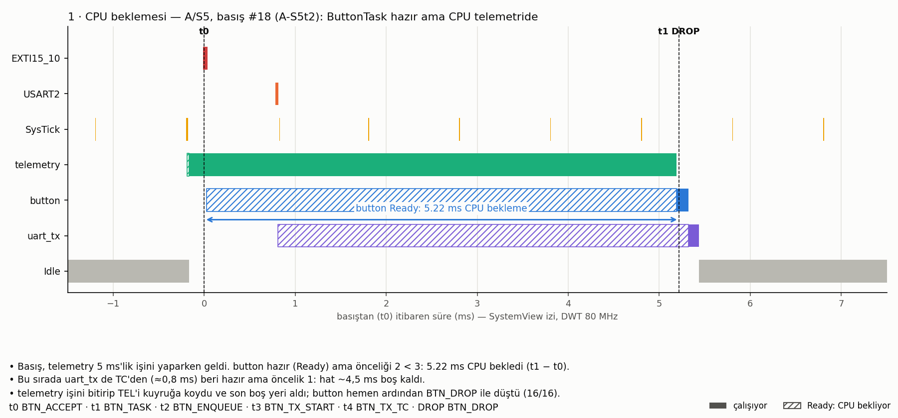
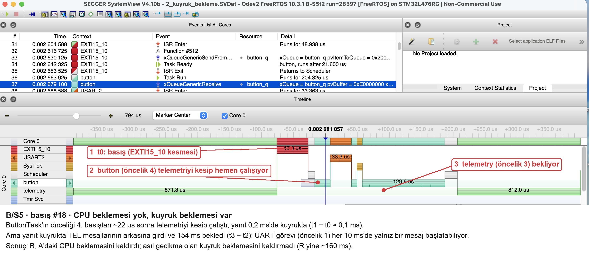
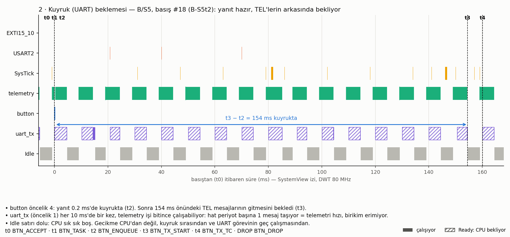
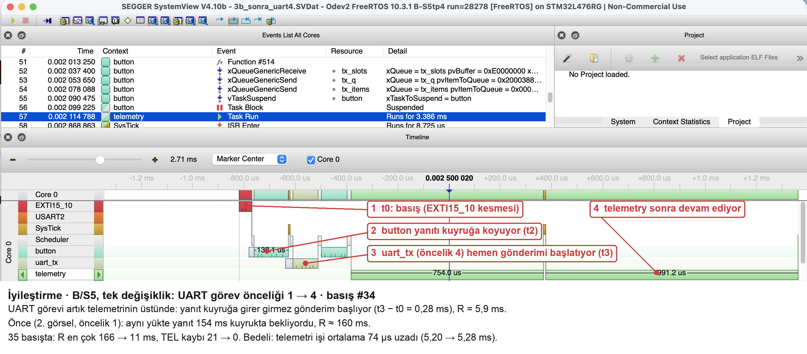
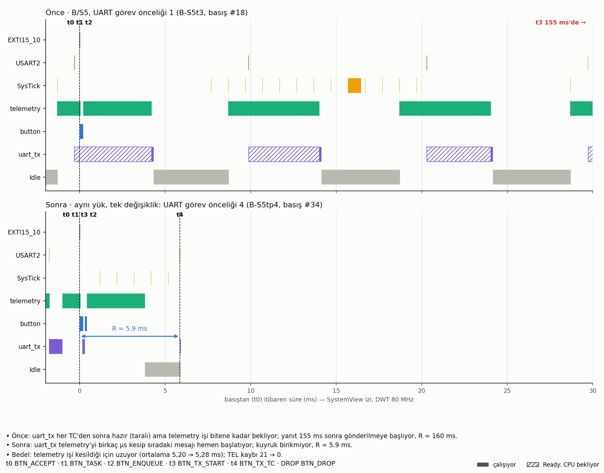

# SystemView Ödevi: A/B/C'yi iz üzerinden açıklamak

Ham veri: [`../measurements/`](../measurements/), izler: [`../traces/`](../traces/), eşleşme: [`../experiment.csv`](../experiment.csv).

Görseller iki türlü:
- **SystemView ekran görüntüleri** (`screenshots/*_isaretli.png`): SystemView V4.10b'de açılan kısa pencere dosyalarından ([`../traces/ekran/`](../traces/ekran/), [`sv_window.py`](sv_window.py)) alındı, işaretler [`annotate.py`](annotate.py) ile eklendi.
- **İzden çizilen zaman çizelgeleri** (`figures/*.png`): aynı `.SVDat` dosyalarından [`sv_figures.py`](sv_figures.py) ile; olay adları ve Ready aralıkları burada görünür.

## 1. Kayıt yöntemi

J-Link yok; yalnız kart üstü ST-LINK var (macOS). Bu yüzden canlı kayıt yerine **RAM'e halka kayıt** kullanıldı:

- SystemView **post-mortem** modunda 32 KB'lık RAM tamponuna yazar; en eski veri üzerine yazılır.
- Kayıt ölçüm başlayınca açılır, export başlarken durur. Tampon `END` satırından sonra USART2'den hex olarak gönderilir (FNV-1a ile doğrulanır), PC'de `.SVDat` olur.
- Bir iz son **~1,0 s** (S5) ya da **~1,6 s** (S6) kadarını tutar. S5'te bir pencereye 1–2 basış sığdığı için ek kısa kayıtlar alındı (ödevin "kısa kayıtlar" seçeneği).
- Uygulama olayları t₀…t₄ noktalarında, olay kimliğiyle: `BTN_ACCEPT`, `BTN_TASK`, `BTN_ENQUEUE`/`BTN_DROP`, `BTN_TX_START`, `BTN_TX_TC`. USART2 kesmesi yalnız TC anında kaydedilir; bayt başına TXE kesmeleri tamponu doldururdu.
- İzden okunan aralıklar CSV'deki TIM2 ölçümleriyle ~10 µs içinde aynı (ör. B-S5t2 #18: iz 154 527 µs, CSV 154 537 µs).

SystemView V4.10b bu dosyalarda uygulama olaylarını `Function #512…#517` diye gösteriyor (512 = BTN_ACCEPT … 517 = BTN_TX_TC). Adlar için [`../SYSVIEW_Odev2_BTN.txt`](../SYSVIEW_Odev2_BTN.txt) *Project → Description Files* ile yüklenebilir.

## 2. Deney matrisi

| Koşul | Kayıt | Tam t₀→t₄ zinciri (iz içinde) | Yanıt / 20 ms aşan |
|---|---|---|---|
| A/S5 | A-S5t + 4 kısa | 3 (#19, #19, #18) + 9 kayıp zincir | 22/35, 22 |
| B/S5 | B-S5t + 2 kısa | 5 | 35/35, 35 |
| B/S6 | B-S6t + 1 kısa | 6 | 35/35, 2 |
| C/S6 | C-S6t | 3 | 35/35, 0 |
| İyileştirme: B/S5, UART önceliği 4 | B-S5tp4 | 2 | 35/35, 0 |
| İz kapalı: C/S6 | C-S6 | – | 35/35, 0 |

Bütün koşular fiziksel B1 basışlarıyla, aynı firmware (`odev02`) ve tek binary ile alındı.

## 3. A/S5: CPU nerede bekliyor?

Basış telemetry'nin 5 ms'lik işinin içine düştü. button **Ready** ama önceliği (2) telemetry'den (3) düşük: **5,22 ms CPU bekledi**. Aynı anda uart_tx de TC'den beri Ready; hat ~4,5 ms boş kaldı. telemetry işini bitirip TEL'i koydu ve son boş yeri aldı, yanıt `BTN_DROP` ile düştü.

İz, Ödev 2'deki hipotezi doğruluyor: A'daki kayıpların nedeni, son yere telemetry'nin önce varması.

## 4. B/S5: yalnız görev önceliği neyi değiştirdi?

button artık telemetry'yi kesiyor: t₁−t₀ ≈ 0,1 ms. Ama yanıt kuyrukta **154 ms** bekliyor:
- uart_tx (öncelik 1) her 10 ms'de yalnızca bir kez, telemetry işi bitince çalışıyor.
- Hat periyot başına 1 mesaj taşıyor; bu, telemetri hızına eşit. Birikim erimiyor.
- Idle satırı dolu: CPU sık sık boş. Gecikme CPU'dan değil, **kuyruk sırasından ve UART görevinin geç çalışmasından**.

## 5. B/S6 → C/S6: yalnız seçim politikası neyi değiştirdi?

S6'da 4 TEL'lik darbe var. B'de yanıt darbenin arkasına düşerse 4 mesaj bekliyor (t₃−t₂ en çok 17,9 ms, R en çok 23,6 ms, 2 aşım). C'de BTN aktarım sınırında öne geçiyor; bekleme yalnızca hattaki mesajın kalanı (t₃−t₂ en çok 4,3 ms, R en çok 10,0 ms, aşım yok). Bedeli TEL'e: en uzun TEL beklemesi B'de 23,6 ms, C'de 23,8 ms.

## 6. İyileştirme: UART görev önceliği 1 → 4 (tek değişken)

| B/S5 | Önce (öncelik 1) | Sonra (öncelik 4) |
|---|---|---|
| R medyan / en çok | 160,1 / 166,0 ms | 6,8 / 11,0 ms |
| t₃−t₂ ortalama | 123,8 ms | 1,7 ms |
| TEL beklemesi en çok | 150,9 ms | 5,7 ms |
| Kayıp TEL | 21 | 0 |
| telemetry işi ortalama | 5,20 ms | 5,28 ms |

uart_tx her TC'den sonra telemetry'yi birkaç µs kesip sıradaki mesajı başlatıyor; hat boş kalmıyor. Bedel küçük: telemetry işi ~74 µs uzuyor. Bu, Hafta 1'de bulunan kök nedenin doğrudan çözümü.

## 7. İzin sisteme etkisi (C/S6, iz kapalı / açık)

| | İz kapalı | İz açık |
|---|---|---|
| t₁−t₀ ortalama / en çok | 0,05 / 0,06 ms | 0,15 / 0,86 ms |
| t₄−t₃ ortalama | 5,565 ms | 5,653 ms |
| R medyan / en çok | 5,78 / 11,05 ms | 5,91 / 10,02 ms |
| telemetry periyodu en çok | 100,04 ms | 101,06 ms |
| Stack boş payı (uart_tx / telemetry) | 146 / 156 word | 72 / 68 word |

Kayıt bedava değil. Post-mortem modunda her 256 pakette bir görev listesi ve sistem bilgisi yeniden yazılıyor; bu, araya ~0,8 ms ekleyebiliyor (görsel 3'te SysTick satırındaki uzun blok). Ayrıca stack kullanımı arttı; ilk denemede 128 word'lük inject görevi taştı ve 256 word'e çıkarıldı. Ortalama R'ye etkisi küçük (+0,1 ms), en kötü duruma etkisi ~1 ms.

## 8. Sınırlar

- Her pencere ~1 s; pencere dışındaki olaylar görülmez. Tam zincir sayısı her koşul için 3–6.
- İz açıkken zamanlama biraz değişiyor (bölüm 7); iz görselleri bu etkiyi içerir.
- 35 basış en kötü durumu kanıtlamaz. Basışlar elle yapıldı, faz kontrol edilmedi.
- SystemView V4.10b, uygulama olaylarının adlarını post-mortem dosyada otomatik çözmedi; görseller bu yüzden izden kendi betiğimizle çizildi. Kaynak `.SVDat` dosyaları SystemView'de açılır.
- Sonuçlar bu firmware'e özgü (FreeRTOS 10.3.1, -O0, 115200 baud, UART IT + TC bildirimi).
