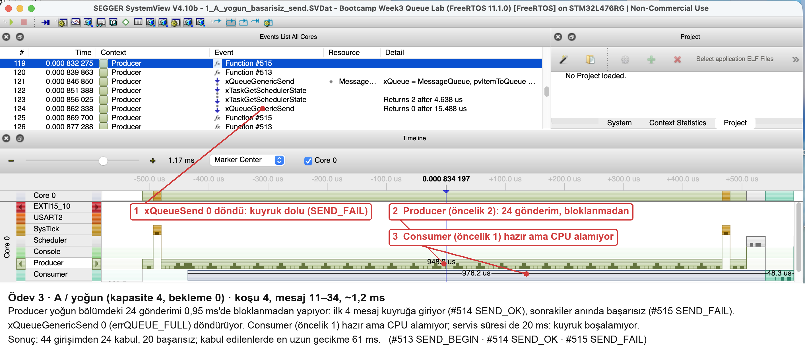
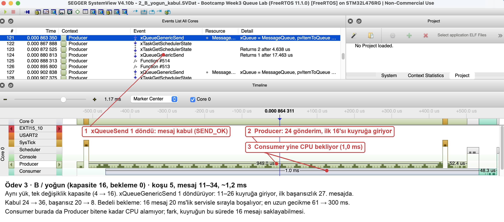
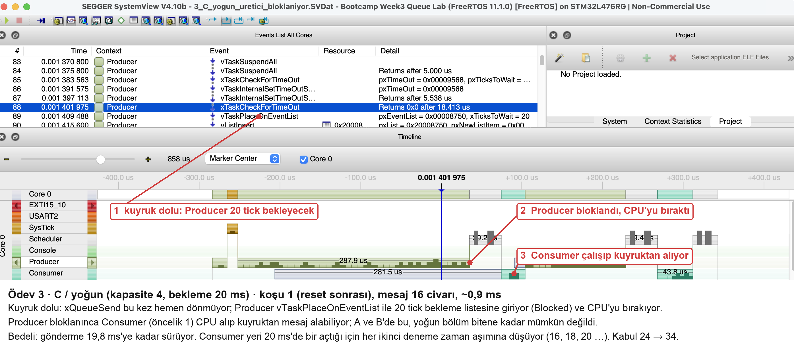

# Ödev 3: Kuyruk dolunca sistemim ne yapıyor?

Tablo [`summary.py`](summary.py) ile ham dosyalardan üretildi ([`summary.csv`](summary.csv)). İzler [`../traces/`](../traces/), görseller [`screenshots/`](screenshots/).

## Veri yolu

```
Producer (öncelik 2) ──xQueueSend(Message, bekleme)──▶ [ kuyruk: 4 ya da 16 × 12 B ] ──xQueueReceive──▶ Consumer (öncelik 1)
  44 girişim, her biri 100 ms arayla                                                      her mesajda 20 ms servis (vTaskDelay)
  yoğun: 10 normal + 24 art arda + 10 normal
```

- Gönderilen şey **struct kopyası** (`sequence`, `generated_us`, `value`), işaretçi değil.
- Kuyruk boşken Consumer `xQueueReceive(…, 25 ms)` ile **Blocked** bekliyor.
- Kuyruk doluyken Producer A ve B'de **hemen** dönüyor (bekleme 0); C'de **20 ms Blocked** bekliyor.
- Başarısız gönderim `xQueueSend` dönüş değeri `pdPASS` değilse sayılıyor (`failed`, `SEND_FAIL`).
- 20 ms servis `vTaskDelay` ile modellenmiş bir dış bekleme; CPU yükü değil.

## Sonuçlar

| # | Varyant | Yük | İz | Girişim | Kabul | Başarısız | Tüketilen | Gecikme ort / maks (ms) | Gönderme maks: kabul / başarısız (ms) |
|---|---|---|---|---|---|---|---|---|---|
| 01 | A (4, 0) | normal | açık | 44 | 44 | 0 | 44 | 0,08 / 0,14 | 0,047 / – |
| 02 | B (16, 0) | normal | açık | 44 | 44 | 0 | 44 | 0,08 / 0,14 | 0,047 / – |
| 03 | C (4, 20 ms) | normal | açık | 44 | 44 | 0 | 44 | 0,08 / 0,14 | 0,047 / – |
| 04 | A | yoğun | açık | 44 | 24 | 20 | 24 | 5,22 / 60,87 | 0,047 / 0,029 |
| 05 | B | yoğun | açık | 44 | 36 | 8 | 36 | 78,68 / 300,43 | 0,046 / 0,058 |
| 06 | C | yoğun | açık | 44 | 34 | 10 | 34 | 27,20 / 80,37 | 0,209 / 19,773 |
| 07 | A | yoğun | kapalı | 44 | 24 | 20 | 24 | 5,08 / 59,94 | 0,030 / 0,016 |

Bütün koşularda girişim = kabul + başarısız ve kabul = tüketilen. Normal yükte (100 ms arayla, 20 ms servis) kuyruk hiç dolmuyor; üç varyant aynı.







## Tartışma

**① B daha fazla mesaj kabul etti mi, bedeli ne?**
Evet: kabul 24'ten 36'ya çıktı, başarısız 20'den 8'e indi. Bedeli gecikme: kuyruktaki 16 mesaj 20 ms'lik servisle sırayla boşalıyor. Ortalama gecikme 5,2 ms'den 78,7 ms'ye, en uzun gecikme 61 ms'den **300 ms**'ye çıktı. Büyük kuyruk, kaybı gecikmeye çeviriyor.

**② C'de üretici ne kadar bekledi, bunun etkisi ne?**
Başarısız gönderimlerde Producer **19,8 ms**'ye kadar Blocked kaldı. Kabul edilen bir gönderim bile 0,21 ms sürebildi. Bu sürede Producer başka iş yapamaz; gerçek bir sistemde üreticinin başka bir periyodik görevi varsa onu kaçırır.

İzde ilginç bir ayrıntı görülüyor (görsel 3 ve `traces/` içindeki C/yoğun):
- Başarısız gönderimler **sırayla** geliyor: 16, 18, 20 ….
- Producer 20 ms bekliyor; Consumer da yeri her 20 ms'de bir açıyor.
- Bekleme süresi, yer açılmadan ~0,2 ms önce bitiyor: 16. mesaj 20,02 ms'de zaman aşımına düşüyor, Consumer yeri 20,18 ms'de açıyor ve onu 17. mesaj alıyor.

Bekleme süresi, servis süresinden biraz uzun olsaydı bu kayıplar büyük ölçüde kalkardı. Bu bir hipotez, ölçülmedi.

A ve B'de Producer hiç bloklanmadığı için Consumer (öncelik 1) yoğun bölüm bitene kadar CPU alamıyor (görsel 1–2: ~1 ms Ready). C'de Producer bloklanınca Consumer araya girebiliyor.

**③ İz açık/kapalı farkı (A/yoğun, 04 ve 07)**
Kabul ve kayıp aynı (24/20); davranış değişmedi. İz açıkken her gönderme çağrısına ~17 µs ekleniyor (kabul edilenlerde en uzun 0,030 → 0,047 ms). En uzun gecikme 59,9'dan 60,9 ms'ye çıktı. İz, olay başına küçük bir maliyet ekliyor ama bu yükte sonucu değiştirmiyor.

**④ Hangi politikayı seçerdim?**
Veriye göre değişir:
- **Telemetri** (eski veri değersiz): A gibi bekleme 0. Kuyruk doluysa yeni veriyi düşürmek ya da üstüne yazmak, üreticiyi bekletmekten iyi.
- **Komut / buton yanıtı** (kaybolmamalı, ama geç gelirse de işe yaramaz): kısa bir bekleme ile C, ve bekleme süresi servis süresinden bir pay fazla. B'nin 300 ms'lik gecikmesi Hafta 2'deki 20 ms'lik yanıt hedefini zaten aşardı.

**⑤ Ölçüm neyi kapsamıyor?**
- **Tekrar yok:** her koşul bir kez çalıştırıldı; tekrarlar arası değişim ölçülmedi.
- **Kısa iz penceresi:** iz yalnız 200 ms'lik pencereyi kapsıyor. CSV 44 mesajın hepsini kapsıyor, iz kapsamıyor.
- **Yapay servis süresi:** 20 ms'lik servis sabit bir `vTaskDelay`. Gerçek bir UART ya da çevre birimi değişken sürer.
- **Tek kart ve tek derleme:** CubeIDE Debug derlemesi kullanıldı; eğitmenin CMake derlemesiyle hash farklı, ama kaynak aynı.
- **Ara reset:** 05 ile 06 arasında USB bağlantısı koptu ve kart yeniden başladı; 06 ve 07'nin `run_id`'si 1'den başlıyor. Ölçümü etkilemiyor, her koşu kendi `RUN` komutuyla sıfırdan başlıyor.
- **Garanti değil:** gözlenen en uzun değerler worst-case değil.
